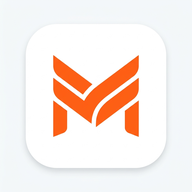
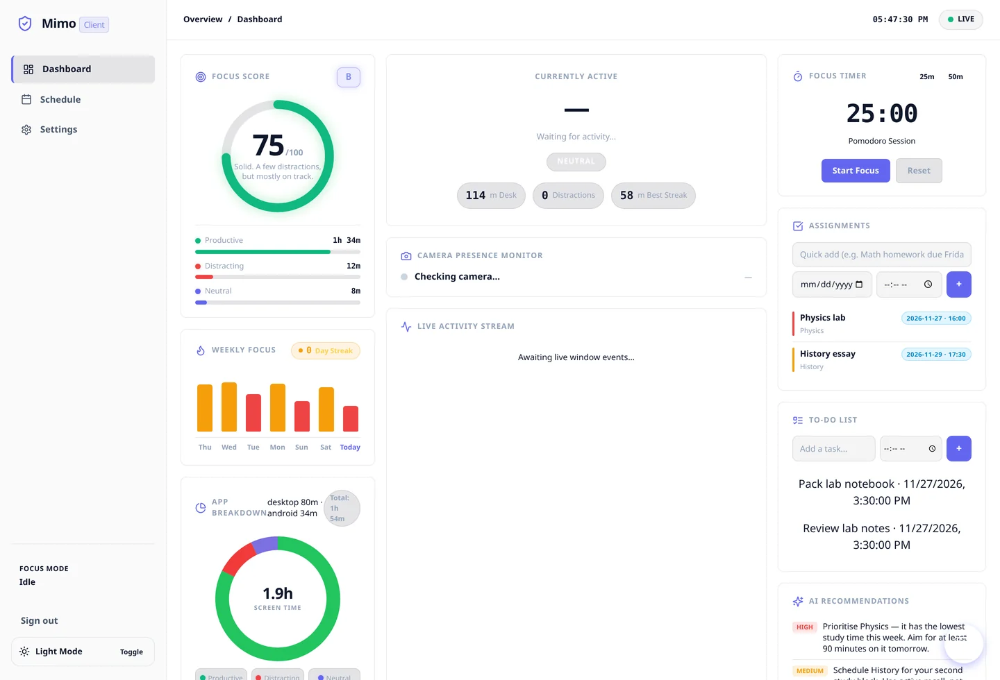

<p align="center"></p>

# Mimo

Mimo helps students fit study sessions around classes, keep track of deadlines and see where their screen time goes. The Windows app and Android companion share an account with the web dashboard. Students can invite a parent to view a weekly summary.

[](https://github.com/SAM18-Bot/Mimo/actions/workflows/backend.yml)
[](https://github.com/SAM18-Bot/Mimo/actions/workflows/desktop.yml)
[](https://github.com/SAM18-Bot/Mimo/actions/workflows/android.yml)

## Downloads

Sign in to GitHub to download an Actions artifact. For either app, open a successful build on `main` and select the named file under **Artifacts**.

| Get | GitHub download | What to open |
| --- | --- | --- |
| Windows 64-bit | [Windows builds](https://github.com/SAM18-Bot/Mimo/actions/workflows/desktop.yml?query=branch%3Amain) · `Mimo-Windows` | Extract the entire ZIP and run `Mimo.exe` alongside its bundled libraries. |
| Android 8.0+ | [Android builds](https://github.com/SAM18-Bot/Mimo/actions/workflows/android.yml?query=branch%3Amain) · `Mimo-Android-debug` | Extract the ZIP and open `app-debug.apk` on the phone. This is the debug build. |
| Promotional videos | [Download the promo kit](https://github.com/SAM18-Bot/Mimo/actions/runs/45913240450/artifacts/15160998421) | Extract the vertical and widescreen MP4s and the English captions. GitHub applies its artifact retention period. |

## What Mimo does

| During the study week | In Mimo |
| --- | --- |
| Plan around existing commitments | Enter school hours, fixed activities and a study goal to generate a weekly schedule. Add assignments with due times and to-dos with reminders. |
| Start a focused session | Choose a 25-minute Pomodoro or a 50-minute deep-work timer. During scheduled study, Windows can close distracting apps after their limit. Android can send a reminder. |
| Review a day | Compare productive and distracting app use, focus scores and weekly patterns. An optional ESP32-CAM can add desk-presence events. |
| Get help and share progress | Ask the coach what is due, complete a check-in or review the daily report. Connect Gemini for model-generated advice. A linked parent can see study time and focus trends in their own portal. |



## Run the dashboard locally

Use Python 3.11 from the repository root. These commands start a local SQLite-backed server on macOS or Linux. Windows PowerShell commands are in the [contributor guide](CONTRIBUTING.md#local-development).

```bash
python -m venv .venv
source .venv/bin/activate
python -m pip install -r requirements_server.txt
NO_HARDWARE=1 NO_VOICE=1 python -m uvicorn server.main:app --host 127.0.0.1 --port 8000
```

Open the [student dashboard](http://127.0.0.1:8000/), [parent portal](http://127.0.0.1:8000/parents) or [API reference](http://127.0.0.1:8000/docs). On first startup, Mimo applies its database migrations. Email registration works with the local configuration.

## Repository guide

| Directory | What lives there |
| --- | --- |
| [server/](server/) | FastAPI application, configuration, [API and WebSocket routes](server/api/), [database models and migrations](server/db/), [study and tracking logic](server/modules/) and [scheduled jobs](server/schedulers/). |
| [web/](web/) | Student dashboard, planner, settings and parent portal. The server serves these pages and their bundled assets. |
| [desktop/](desktop/) | Windows launcher, tray and tracking code, app assets, PyInstaller packaging and desktop tests. |
| [android/](android/) | Kotlin and Jetpack Compose app, Gradle wrapper, unit tests and instrumented device tests. |
| [firmware/](firmware/) | Optional ESP32-CAM [Arduino sketch](firmware/cam_stream/cam_stream.ino). |
| [tests/](tests/) and [scripts/](scripts/) | Python integration tests, browser and device checks, packaging checks and web asset tooling. |
| [.github/workflows/](.github/workflows/) | Backend and container checks, Windows packaging and Android builds and device tests. |

## Build, deploy or contribute

- Build a Windows bundle or Android APK and connect it to your server. [Client guide](docs/clients.md)
- Run PostgreSQL with Docker Compose or deploy the service on Render. [Deployment guide](docs/deployment.md)
- Set up a development environment, run tests and contribute a change. [Contributing](CONTRIBUTING.md)

Earlier project plans and setup notes are kept in the [documentation archive](docs/archive/).

## License

Mimo is licensed under the MIT License. The bundled dashboard libraries and optional face-landmark model have their own notices. [Web library notices](web/vendor/) · [Model license](server/modules/cv_pipeline/models/LICENSE.txt)
